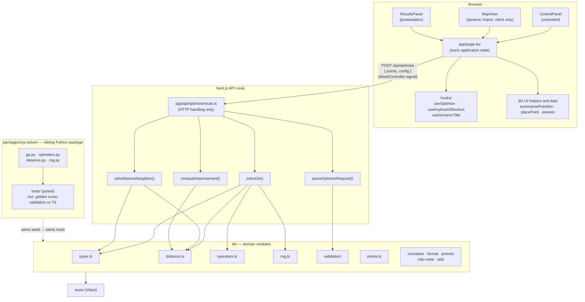
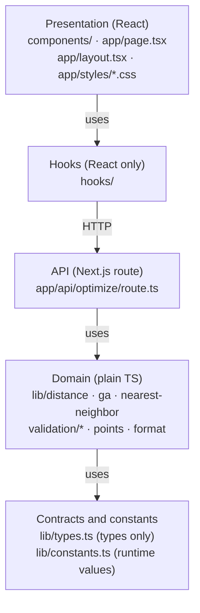

# Architecture

This document is for people who want to change the code, not just run it. The [README](./README.md) says what the demo does. This file says where things live, how they talk to each other, and which boundaries to keep. If the code and this document disagree, trust the code and fix the document.

**Scope.** This covers the TypeScript web app under `src/`. The Python package in `packages/vrp-solver/` shares no code with it and is described in its own [README](./packages/vrp-solver/README.md). How the two relate is in [`docs/PROVENANCE.md`](./docs/PROVENANCE.md). Visual design is in [`docs/DESIGN.md`](./docs/DESIGN.md).

## System overview

The browser never calls the algorithm directly. It sends points and config to a thin API route over HTTP, and the route validates, solves and shapes the response. Everything under `lib/` is plain TypeScript with no framework imports, so it runs in Node, in tests, or later in a worker.



## Layers and rules

Dependencies only point downward.



Rules:

- `lib/types.ts` contains types only and has no runtime imports.
- `lib/*.ts` does not import React or Next. The one exception is `lib/utils.ts`, a small `clsx` + `tailwind-merge` helper for the UI. `lib/role-meta.ts` is plain data.
- `app/api/*` never imports from `components/` or `hooks/`.
- `components/*` never imports from `app/api/*`. The UI goes through HTTP.
- `hooks/*` depend only on `lib/`, never on `components/`.
- Only `app/page.tsx` holds application state. Child components are either controlled (`ControlPanel`, `ResultsPanel`) or own only Leaflet's internal state (`MapView`).
- `lib/validation/` is a directory, but its `index.ts` exports exactly three names: `ValidationError`, `parseOptimizeRequest` and `requireStartAndEnd`. The other files in it are internal.
- `packages/vrp-solver/` imports nothing from `src/`, and `src/` imports nothing from it. The only link is the cross-validation test. If the two shared code, the test could no longer show that they agree independently.

If you find yourself breaking one of these, it usually means a shortcut around the HTTP boundary or a UI concern leaking into the algorithm.

## Data flow

### Placing a point

```text
Click on the map
  → MapClickHandler (react-leaflet useMapEvents)
  → MapView.onMapClick(lat, lng)
  → page.tsx handleMapClick
  → placePoint(points, clickMode, lat, lng, id)   (pure, lib/points.ts)
  → setPoints([...])
  → reset()   (clears result, aborts any in-flight request)
```

`placePoint` applies the per-role rules: a new `start` replaces the old one, a new `end` replaces the old one, a `stop` is appended. The `id` is passed in so the function stays pure. The caller is responsible for uniqueness and currently uses `Date.now()`.

Any change to the points invalidates the route, and `reset()` is the single place that does it. Callers don't clear `result`, `error` and `loading` themselves.

### Changing a parameter

```text
Drag a slider
  → ControlPanel.onConfigChange(newConfig)
  → page.tsx handleConfigChange
  → setConfig(newConfig)
  → reset()
```

### Running the optimizer

```text
Click "Optimize route" or press Ctrl/⌘ + Enter
  → useOptimize.run()
  → abort any in-flight request
  → POST /api/optimize { points, config }   (with AbortController signal)
      route.ts: parse → validate → solveGA → solveNearestNeighbor → respond
  → setResult(data)
  → onSuccess(data): setActiveRoute("ga"), setMobileTab("results")
  → useDynamicTitle updates document.title
  → ResultsPanel and MapView render the new route
```

### Switching between GA and baseline

```text
Click "Baseline" in ResultsPanel
  → page.tsx setActiveRoute("baseline")
  → MapView gets route = baseline.sequence, variant = "baseline"
  → stops are renumbered by baseline visit order
```

No extra request is made. Both routes are already in `result`.

### Resetting

```text
Click "Reset points"
  → page.tsx handleReset()
  → setPoints(INITIAL_POINTS)
  → reset()   (aborts the fetch, clears result, error and loading)
  → setMapKey(k => k + 1)   (remounts MapView so fitBounds runs again)
```

If a request was in flight, its response is dropped: the abort fires and the `try/catch` returns before `setResult`.

## Modules

### `lib/`

| File | Responsibility |
| --- | --- |
| `types.ts` | Shared types: `Point`, `PointRole`, `Objective`, `GAConfig`, `FitnessHistoryPoint`, `RouteSolution`, `GAResult`, `BaselineResult`, `Preset`, `OptimizeRequest`, `OptimizeResponse` |
| `constants.ts` | Physics constants, `MIN_POINTS` / `MAX_POINTS`, `VALID_ROLES`, `VALID_OBJECTIVES`, `DEFAULT_GA_CONFIG`, `GA_CONFIG_BOUNDS`, `GITHUB_REPO_URL` |
| `distance.ts` | `haversineDistance`, `evaluateSequence`, `computeImprovement` |
| `operators.ts` | `orderCrossover`, `swapMutation`, `tournamentSelect` |
| `rng.ts` | `createRng`, `shuffle`, `randomIndex` |
| `ga.ts` | `solveGA` |
| `nearest-neighbor.ts` | `solveNearestNeighbor`, the baseline |
| `validation/` | Request parsing and domain checks |
| `points.ts` | `summarizePointSet`, `placePoint` |
| `format.ts` | `formatDistance`, `formatTime` |
| `presets.ts` | `INITIAL_POINTS` and the three `PRESETS` |
| `role-meta.ts` | Labels and colors per point role |
| `utils.ts` | `cn()` |

Some details worth knowing:

**`types.ts` and `constants.ts`.** Types and runtime values are kept apart. `VALID_ROLES` and `VALID_OBJECTIVES` use `as const satisfies`, so TypeScript flags it if they drift from the types.

**`distance.ts`.** No state and no randomness. `evaluateSequence(points, sequence, objective)` returns `{ sequence, totalDistance, totalTime, fitness }`. `computeImprovement(baseline, candidate)` returns a fraction clamped to `[0, 1]`.

**`operators.ts`.** The operators are exported functions, not private to `ga.ts`, so tests can call them directly. `swapMutation` returns a new array and doesn't change its input.

**`rng.ts`.** `createRng(seed)` returns a mulberry32 generator when a seed is given and `Math.random` otherwise. `shuffle` is Fisher–Yates and doesn't mutate. Determinism with a seed is a contract: the tests and the Python cross-validation both rely on it.

**`validation/`.**

| File | Responsibility |
| --- | --- |
| `index.ts` | Public facade |
| `error.ts` | `ValidationError`, which the API route maps to HTTP 400. No dependencies, so the other files can import it without a cycle. |
| `primitives.ts` | `isObject`, `asNumber`, `asIntInRange`, `isValidRole`, `isValidObjective` |
| `fields.ts` | `parsePoint`, `parseConfig` |
| `request.ts` | `parseOptimizeRequest` (runs the field parsers in the order listed under [Validation order](#validation-order)) and `requireStartAndEnd`, which both solvers use as a safety check |

**`points.ts`.** `summarizePointSet(points)` returns `{ startCount, endCount, stopCount, isReady, missing }` and is the only place that decides whether a point set is ready to optimize. The control panel uses it for the disabled button and the hint, and `page.tsx` uses it for the status pill and the shortcut.

**`ga.ts`.** `solveGA(points, config)` does this:

1. `requireStartAndEnd(points)`.
2. With zero stops, return the single start→end route.
3. `createRng(config.randomSeed)`.
4. Create `populationSize` shuffled permutations.
5. For each generation: sort, record best and average, breed the next generation.
6. Return the best individual, the history and the number of generations run.

Three private helpers (`snapshotGeneration`, `breedNextGeneration`, `breedOffspring`) keep the main function readable. They aren't exported, and `ga.test.ts` tests the whole pipeline instead of the helpers.

**`nearest-neighbor.ts`.** From the current point, go to the nearest unvisited stop, then finish at the fixed end.

**`format.ts`.** `formatDistance(meters)` gives `"12.35 km"`. `formatTime(seconds)` gives `"45s"`, `"5m 5s"` or `"1h 25m"` (seconds are dropped above one hour).

**`role-meta.ts`.** `ROLE_META` maps each role to its label and colors, and `ROLE_ORDER` is `["start", "stop", "end"]`. It replaced two near-identical maps in `ControlPanel` and `ResultsPanel`.

### `app/api/optimize/route.ts`

A thin wrapper:

1. `await req.json()`. If that fails, return `400` with `{ error: "Invalid JSON body" }`.
2. `parseOptimizeRequest(body)`. On `ValidationError`, return `400` with its message.
3. Run `solveGA`, `solveNearestNeighbor` and `computeImprovement`.
4. Return `200` with an `OptimizeResponse`.

There is no algorithm or validation logic in this file.

### `app/page.tsx`

The only state owner.

| State | Purpose |
| --- | --- |
| `points: Point[]` | Markers on the map |
| `config: GAConfig` | GA parameters |
| `clickMode: PointRole` | What the next map click creates |
| `activeRoute: "ga" \| "baseline"` | Which route is shown |
| `mapKey: number` | Bumped to remount the map on reset or preset load |
| `mobileTab: MobileTab` | Visible panel on mobile |

Everything else comes from hooks: `useOptimize` gives `run`, `reset`, `loading`, `error` and `result`; `useDynamicTitle(result)` syncs the tab title; `useKeyboardShortcut` binds <kbd>Ctrl</kbd>/<kbd>⌘</kbd> + <kbd>Enter</kbd> to `run` while the point set is ready and nothing is loading. There is no `useEffect` in the page body and no `useState` for `result`, `error` or `loading`.

`handleMapClick` delegates to `placePoint`, and `sidebarClass(side, mobileTab)` builds the class names for the two side panels.

### `hooks/`

**`useOptimize`** is the most important one. It handles:

- the fetch: POST `/api/optimize`, JSON in and out, 4xx and 5xx turned into error messages;
- concurrency: calling `run()` again aborts the previous request;
- reset safety: `reset()` aborts any in-flight request, so a stale result can't appear after the user adds a point mid-run;
- callback stability: `onSuccess` is stored in a ref, so `run` keeps the same identity even if the caller passes an inline function;
- loading state: `setLoading(false)` runs in `finally`, but only for the current controller, so a superseded run can't clear the loading flag of the newer one.

Return shape:

```typescript
{
  run: () => Promise<void>;
  reset: () => void;
  loading: boolean;
  error: string | null;
  result: OptimizeResponse | null;
}
```

**`useDynamicTitle`** sets `document.title` from `result.improvementPercent` after hydration. The `Metadata` in `layout.tsx` stays the source for server rendering and link previews.

**`useKeyboardShortcut`** is a generic keybinding hook with two effects. One keeps the latest `handler` in a ref. The other attaches the `keydown` listener and only re-runs when `key`, `ctrlOrMeta` or `enabled` change, so a new handler identity doesn't re-attach it.

### Components worth a note

**`Header` and `StatusPill`.** `Header` holds the logo, title, status pill and GitHub link. `StatusPill` is separate because it is a four-state machine (`loading`, `hasResult`, `ready`, `not ready`) with its own props. `HeaderProps` is an alias of `StatusPillProps`.

**`ConvergenceSparkline` and `sparkline-geometry.ts`.** The component renders the SVG, creates the gradient ID with `useId` and handles the animation. `sparkline-geometry.ts` holds the math: Y-axis inversion, the `best` and `average` paths, the fill path and the animation key. `computeSparklineGeometry` throws when `history.length < 2`; the component returns `null` before that can happen, so the throw is only a guard.

## Algorithm implementation

The README describes the algorithm. These are the implementation details.

**Encoding.** `chromosome = [stopId_1, …, stopId_n]` and `fullRoute = [startId, ...chromosome, endId]`. Only stops are permuted, so the search space is `n!` instead of `(n+2)!`.

**Fitness.** `evaluateSequence` sums haversine distances in meters and divides by `AVERAGE_SPEED_MS` for time. `fitness` is whichever the objective selects, and lower is better. The speed is constant, so both objectives rank routes the same way.

**Tournament selection.** Draw `k` individuals with replacement and return the one with the lowest fitness. A higher `k` converges faster and risks converging too early. Bounds are `2..10`.

**Order crossover.** Pick two cut points, copy `p1[start..end]` into the child at the same positions, then fill the remaining positions from `p2` in order, skipping genes already present. The child is always a valid permutation, so no repair step is needed.

**Swap mutation.** Swap two distinct random positions. It runs per offspring with probability `mutationRate`.

**Elitism.** The top `elitismCount` individuals carry over unchanged. That guarantees `history[g].best <= history[g-1].best`, which the tests assert, and the final result is never worse than the best of the initial population. Bounds are `1..10`, and `elitismCount` must be below `populationSize` (checked in `parseOptimizeRequest`).

**Determinism.** With `config.randomSeed` set, `createRng` returns mulberry32 and the run is repeatable. Tests always set a seed. The UI never does, so runs in the browser differ each time.

The Python package uses the same mulberry32, ported line by line. Given the same seed, both implementations draw the same random numbers and the operators consume them in the same order. [`docs/PROVENANCE.md`](./docs/PROVENANCE.md) explains how this is checked.

## State management

**Ownership.** All application state is in `app/page.tsx`, except the optimize lifecycle (`loading`, `error`, `result`, inside `useOptimize`) and Leaflet's internals (tile cache, viewport, popups). There is no Redux, Zustand or Context. The state is small and lives on one page. If persistence is ever needed, a single `Context` provider around `page.tsx` is the migration path.

**Invalidation.** Any change to `points` or `config` sets `result` to `null` and aborts any in-flight request. This lives in `useOptimize.reset()`. Keeping an old route on screen while the points change would show a route that doesn't match what's on the map.

**Loading.** `useOptimize.loading` disables the Optimize button, shows the map overlay with a spinner, disables the shortcut, and puts `Optimizing…` in the status pill. There is no cancel button. Any change to points or config cancels the request through `reset()`.

**Errors.** `useOptimize.error` is set when the request fails and shown in `ControlPanel` with `role="alert"`. `reset()` or a later successful run clears it.

## React 19 constraints

**Latest-ref pattern.** React 19 doesn't allow writing to `ref.current` during render (`react-hooks/refs`). So this old pattern is out:

```typescript
const ref = useRef(handler);
ref.current = handler; // flagged by the linter
```

and the ref is updated in an effect instead:

```typescript
const ref = useRef(handler);
useEffect(() => {
  ref.current = handler;
}, [handler]);
```

The effect runs before any user event can fire, so the ref holds the latest value whenever `run` or the `keydown` handler executes. `useOptimize` and `useKeyboardShortcut` both use this.

**`useId` for SVG gradients.** A fixed gradient ID would collide if the sparkline rendered twice on a page, because the second `url(#sparkFill)` would point at the first gradient. `useId` gives each instance its own ID and is stable across server and client rendering.

**No mutation during render.** `SequenceDisplay` used to increment a `visitIndex` variable inside `sequence.map()`. It worked, but mutating a variable during render is fragile. It now builds a `SequenceItem[]` in a `for` loop before `return` and renders from that.

## Map rendering

`MapView` sits between React's declarative model and Leaflet's imperative one.

**Draw-in animation.** In `RoutePolyline`, a `useLayoutEffect` reads the rendered SVG path from `lineRef.current?.getElement()`, sets `strokeDasharray` and `strokeDashoffset` to the path length, forces a reflow with `getBoundingClientRect()`, then sets `strokeDashoffset = 0` with a CSS transition. It runs when the route changes, detected by joining the sequence into a key. The baseline skips it, because its `dashArray: "8 8"` would conflict with the animation's `strokeDasharray`.

**Stop numbers.** `useStopNumbers(points, route)` returns a `Map<string, number>`. With a route it holds visit order. Without one it holds creation order. `SequenceDisplay` uses the same visit-order logic, so the map and the sidebar always agree.

**Auto-fit.** `FitBoundsOnce` runs once per mount, guarded by `useRef(false)`. To fit again after a preset load or reset, `page.tsx` changes `mapKey` and the map remounts.

**Dynamic import.** `MapViewWrapper` uses `next/dynamic` with `ssr: false`, because Leaflet needs a DOM. It is the only part of the map the rest of the app imports, and its props are exactly `MapViewProps`.

**Leaflet boundary.** The code uses react-leaflet components and hooks (`MapContainer`, `Marker`, `Polyline`, `Popup`, `TileLayer`, `useMap`, `useMapEvents`). Imperative Leaflet calls are limited to a few `useLayoutEffect`s and refs.

## API contract

```typescript
interface OptimizeRequest {
  points: Point[];
  config: GAConfig;
}

interface OptimizeResponse {
  ga: GAResult;
  baseline: BaselineResult;
  improvementPercent: number; // a fraction in [0, 1], not a percentage
}
```

Errors: `400` for invalid points or config and `500` for unexpected server errors, both with `{ error: string }`.

### Validation order

`parseOptimizeRequest` checks, in this order:

1. The body is an object.
2. `points` is an array.
3. The number of points is within `[MIN_POINTS, MAX_POINTS]`.
4. Each point is valid (`id`, `lat`, `lng`, `role`, optional `label`).
5. There is exactly one `start` and one `end`.
6. No ID appears twice.
7. `config`, if present, has every numeric field within `GA_CONFIG_BOUNDS`.
8. `elitismCount < populationSize`.

The order decides which error the user sees first. All points are parsed (step 4) before roles are counted (step 5), so a malformed point gets a point-level error even when the role count is also wrong.

### Python parity

`packages/vrp-solver/` accepts the same request and returns the same response, through its CLI (`vrp-solver problem.json`) and its Python API (`parse_optimize_request`, `solve_ga`, `solve_nearest_neighbor`, `compute_improvement`). Field names are camelCase on both sides so the JSON is identical.

## Type contracts

- **Domain to API:** the API only uses types from `lib/types.ts`, so adding a field to `Point` is a one-line change both layers see.
- **API to UI:** `OptimizeResponse` is the only shape the UI reads from the network. There are no partial or streamed responses.
- **UI to components:** every component has an explicit `Props` interface and there are no `any` bridges, so a type change shows up at every call site.
- **TypeScript to Python:** the two sides are parallel, not shared. TypeScript declares interfaces in `lib/types.ts`. Python declares dataclasses and Pydantic models in `types.py` and `validation.py`. The cross-validation tests catch drift: if a field name or type changes on one side only, the golden tests fail. Generating one side's types from the other would remove the manual sync, but it would also couple the two implementations. If a third implementation is ever added, generation may become worth it.

## Testing

Web app tests are unit tests for `lib/`. There are no component, integration or end-to-end tests. The Python package has its own suite, which doesn't touch the web app, and the web tests don't touch it.

Why they stop at `lib/`:

- The algorithm and the pure helpers are where bugs are subtle, so they get the most coverage.
- The UI is visual and interactive, and checking it by hand is faster than maintaining snapshot tests.
- The API route is a thin wrapper, so testing `lib/validation/` and the solvers directly covers more than a mocked HTTP handler would.

Test files in `tests/`: `distance`, `operators`, `format`, `points`, `validation`, `ga` and `nearest-neighbor`.

Not tested automatically:

- **Hooks and components.** Testing them needs `@testing-library/react` and `jsdom`, which is a lot of extra setup for a demo. They are checked by hand before each deploy.
- **Map rendering.** Leaflet has its own tests, and the integration here is small.
- **Sparkline rendering.** The geometry can be tested without the DOM, but only the SVG output is checked by hand.

Two small pure helpers are good candidates for tests: `placePoint` (a table test over the three roles) and `computeSparklineGeometry` (the Y-axis inversion and the `|| 1` range fallback).

### CI

Web app (`.github/workflows/ci.yml`), on every push and pull request:

```text
typecheck → lint → format:check → test → build
```

`npm run ci` runs the same steps locally.

Python package (`.github/workflows/python-solver.yml`), when files under `packages/vrp-solver/` or the workflow itself change:

```text
ruff check → ruff format --check → mypy src/ → pytest
```

## Extension points

### Fits the current structure

- **A new objective, such as fuel.** Add it to `Objective` in `types.ts` and extend `evaluateSequence`. The API and results panel pass it through. Make the same change in `packages/vrp-solver/` and update the golden vectors in `test_cross_validation.py`.
- **A new constraint, such as "visit this stop first".** Add it to `GAConfig`, then either repair the child in `breedOffspring` after crossover and mutation, or replace `swapMutation` with a constraint-aware operator. The Python side needs the same change.
- **URL state (`?points=...&config=...`).** No API change is needed. Serialize in `page.tsx`, read it on mount, and fall back to `INITIAL_POINTS` and `DEFAULT_GA_CONFIG`.
- **Real traffic routing.** Replace `distance.ts` with calls to OSRM or a commercial router. `evaluateSequence` keeps its return shape. The route handler would become async; `useOptimize` already handles that on the client.
- **Saving results.** Add a database write after `solveGA` and a history panel in the UI. `lib/` doesn't change.

### Needs restructuring

- **Multi-vehicle VRP.** The chromosome becomes one permutation per vehicle, and crossover and mutation have to be redesigned. Plan for a new `lib/ga-multi.ts`, a matching Python module and a new endpoint. Cross-validation gets harder because different representations can describe the same solution, so solutions would need a canonical form before comparing.
- **Interacting with the map during a run.** Panning already works, because the loading overlay has `pointer-events-none`. But changing points or config aborts the run. Allowing edits without aborting needs a more careful state model.
- **More than about 25 points.** `MAX_POINTS = 25` because the cost grows with `populationSize × generations × n²`. Much larger sets would block the Node event loop for seconds. This needs `worker_threads` or a job queue, and the UI would need polling or SSE.

## Known constraints

- **`MAX_POINTS = 25`.** A safety cap, so one request doesn't block the server for long. At the default config it finishes in roughly half a second.
- **Synchronous API.** The route blocks the Node event loop while `solveGA` runs. That is fine at this size. Moving to a worker or queue would be a server-side change only, because the client is already async.
- **No cancel button.** `reset()` cancels implicitly whenever points or config change, and runs are short.
- **No component or hook tests.** See [Testing](#testing).
- **The map remounts on reset and preset load** (`key={mapKey}`). That is simpler than calling `fitBounds` imperatively after state changes, and `MapContainer` reuses its DOM node, so the cost is small.
- **No server rendering for the map.** `MapViewWrapper` uses `dynamic(..., { ssr: false })`, so the server sends a dark placeholder with a spinner.
- **`ValidationError` is a class, not a tagged union.** That keeps `err instanceof ValidationError` simple in the route. A future streaming or structured-error API would need a different response shape.
- **Two type systems.** TypeScript and Python types are maintained by hand and checked by the cross-validation tests (see [Type contracts](#type-contracts)).
- **The Python package is a library, not a service.** There is no FastAPI app and no separate deployment. If the web UI ever needs a live Python solver, a service would be built on top of the package.

## Dependency map

Each entry imports only from entries below it. This is a summary, not a full listing.

```text
app/page.tsx
 ├── components/{control, layout, map, results}/*
 ├── hooks/{useOptimize, useDynamicTitle, useKeyboardShortcut}.ts
 └── lib/{constants, points, presets, types, utils}.ts

app/layout.tsx
 ├── lib/constants.ts          (GITHUB_REPO_URL for metadata)
 └── app/globals.css           (imports app/styles/*)

components/control/ControlPanel.tsx → components/ui/*, lib/points.ts, lib/types.ts
components/layout/Header.tsx        → StatusPill.tsx, lib/constants.ts
components/map/MapView.tsx          → FitBoundsOnce, MapClickHandler, RoutePolyline,
                                      StopMarker, useStopNumbers, lib/types.ts
components/results/ResultsPanel.tsx → ConvergenceSparkline, ImprovementBanner,
                                      MetricCard, RouteToggle, SequenceDisplay,
                                      lib/format.ts, lib/types.ts
components/results/ConvergenceSparkline.tsx → sparkline-geometry.ts (pure math, no React)

hooks/useOptimize.ts → lib/types.ts

app/api/optimize/route.ts → lib/{distance, ga, nearest-neighbor, validation, types}.ts
                            (no React, no components, no hooks)

tests/*.test.ts → lib/*.ts
```

There are no import cycles. This is enforced by review, not by tooling. If a change would create one, a shared type probably belongs in `lib/types.ts`, or a shared helper needs its own file.

Two invariants to keep:

- No file in `lib/` except `utils.ts` imports React. That keeps the algorithm usable from Node, workers and tests.
- Outside `lib/validation/`, only `index.ts` is imported. Adding or renaming an internal file there changes nothing for consumers.