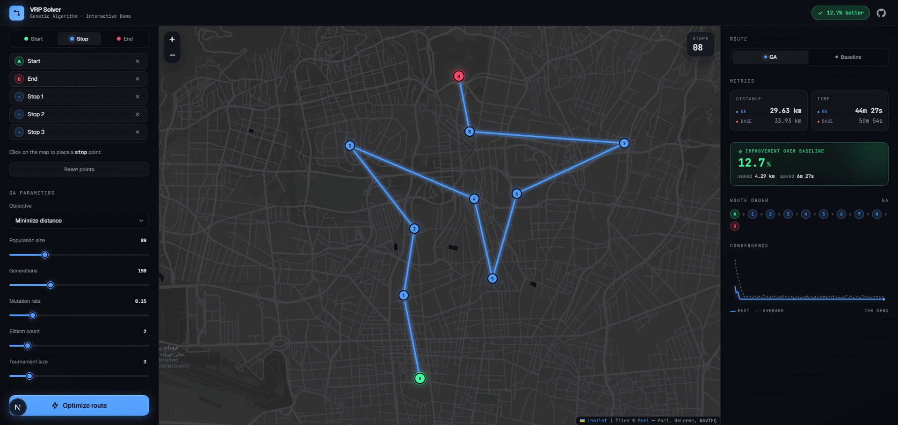

# VRP Genetic Algorithm — Interactive Demo

A browser-based **Vehicle Routing Problem (VRP)** solver built around a **Genetic Algorithm (GA)**. Place points on a dark cartographic map, tune the algorithm's parameters live, and compare the evolved route against a greedy nearest-neighbor baseline.

This project started as my B.Sc. thesis in Geomatics Engineering (GIS), where the algorithm was originally written in Python and C++. The goal of this version isn't to extend that research — it's to make the algorithm something you can explore and verify for yourself.

<p align="center">
  <a href="https://github.com/alan-shabrandi/vrp-demo/actions/workflows/ci.yml">
    
  </a>
  <a href="#testing">
    
  </a>
  <a href="./LICENSE">
    
  </a>
</p>

<p align="center">
  <a href="https://vrp-demo-phi.vercel.app"><strong>Live demo</strong></a>
  &nbsp;·&nbsp;
  <strong>Original thesis:</strong> <em>PDF link to be added</em>
</p>

<p align="center">
  <strong>Stack:</strong> Next.js 16 · React 19 · TypeScript · Tailwind CSS v4 · Leaflet · Vitest
</p>



## Table of contents

- [What it does](#what-it-does)
- [Algorithm](#algorithm)
- [Design](#design)
- [Tech stack](#tech-stack)
- [Project structure](#project-structure)
- [Getting started](#getting-started)
- [Testing](#testing)
- [API](#api)
- [Design decisions worth noting](#design-decisions-worth-noting)
- [Deploy](#deploy)
- [License](#license)

## What it does

- Place a **start (A)**, an **end (B)**, and any number of stops on a dark Esri basemap.
- Adjust GA parameters on the fly: population size, generations, mutation rate, elitism, tournament size, and objective (distance or time).
- Get the best-found visit order, plus a nearest-neighbor baseline for comparison.
- Watch the GA's convergence as an animated sparkline.
- Toggle between the GA route and the baseline with one click, both on the map and in the results panel.
- Choose from three preset scenarios for quick demos.
- Run the solver with <kbd>Ctrl</kbd>/<kbd>⌘</kbd> + <kbd>Enter</kbd>, without reaching for the mouse.
- See the browser tab title update live as the improvement lands (for example, `VRP Solver · 11.1% better`).
- Open the repository from the GitHub icon in the header; the same repository URL is also embedded in the page metadata.

## Algorithm

The problem is modeled as an **open VRP with fixed start and end points**.

- **Chromosome:** A permutation of stop IDs only. Start and end are fixed wrappers around it.
- **Initial population:** Shuffled permutations.
- **Selection:** k-way tournament.
- **Crossover:** Order Crossover (OX), which preserves valid permutations without duplicates or dropped points.
- **Mutation:** A swap, applied per offspring at the configured mutation rate.
- **Elitism:** The top N individuals are carried over untouched, keeping the best fitness non-increasing.
- **Fitness:** Total haversine distance, or total travel time at a constant speed of 40 km/h.

The solver returns a `history` object containing `best` and `average` fitness per generation. This data drives both the convergence analysis and the sparkline in the UI.

### What this demo is not

- **Not a real-traffic router.** Travel time is a constant-speed estimate, not a road-network ETA.
- **Not multi-vehicle.** It models one vehicle and one trip.
- **Not a benchmark against OR-Tools.** The baseline is deliberately simple (nearest-neighbor), so the improvement shown comes from the evolutionary search rather than an already-strong heuristic.

## Design

The visual direction is what I'd call **Cartographic Dark**: it reads more like a scientific instrument than a marketing landing page. Nothing here is purely decorative.

### Visual language

- **Dark palette:** A `#0a0b0f` background with a faint 40px grid and a radial vignette. Surfaces use `rgba(255, 255, 255, 0.03)` with hairline borders rather than solid fills.
- **Semantic color tokens:** Routes, points, and states use CSS variables such as `--color-route-ga`, `--color-route-baseline`, `--color-success`, and `--color-danger`. Changing one token updates the visual system consistently.
- **Monospaced numbers:** Distances, coordinates, parameter values, and improvement percentages use **JetBrains Mono** so values align in columns and read like machine output. UI text uses **Geist Sans**.
- **Distinct route and point colors:** The GA route is blue (`#4f9eff`), while the baseline is dashed orange (`#ff6b4a`). Start is green, end is red, and stops are blue. Points and routes use distinct colors to avoid ambiguity at a glance.

### Map

- **Basemap:** Esri World Dark Gray, which requires no API key. A subtle `brightness(0.72) contrast(1.08) saturate(0.75)` filter brings the tiles closer to the app's background.
- **Custom markers:** Start and End markers pulse with a soft ring; stops are numbered in a monospaced font. Numbers show **visit order** when a route is active (keeping the map and sidebar in sync) and **creation order** otherwise.
- **Polyline:** The GA route uses two layers — a soft glow behind a crisp stroke — with a draw-in animation for each new solution. The baseline is dashed and does not animate.
- **Auto-fit:** The map fits the current point set on mount, so loading a preset adjusts the zoom without requiring a manual pan.

### Layout

- **Desktop:** Three columns — controls (`340px`), map (flexible), and results (`380px`).
- **Mobile:** The map takes `45dvh`; panels collapse into a two-tab bar at the bottom, with `env(safe-area-inset-bottom)` support. The Results tab activates automatically when a run finishes.
- **Header:** A fixed `56px` bar with a live status pill on the right. Its state progresses from `Add points to start` to `Ready · 5 stops`, `Optimizing…`, and finally `11.1% better`. A GitHub icon next to the pill links to the repository.
- **Floating HUD:** Shows the current stop count and warns when Start or End is missing.

### Motion

- `pulse-ring` animates the Start and End markers.
- `stroke-dashoffset` draws in the GA polyline. Its length is measured per render so the animation remains accurate when the route changes.
- `pathLength={1}` and `sparkline-draw` animate the convergence curve.
- `fade-in` and `slide-up` animate panels and popovers.
- All animations respect `prefers-reduced-motion: reduce`.

### Accessibility

- The focus ring uses the brand blue instead of the browser default.
- `--color-fg-dim` is `#7f8491`, adjusted from the original value to meet WCAG AA contrast on 10–11px labels.
- All controls are keyboard-navigable. Sliders have visible focus states; `Enter` / `Ctrl+Enter` runs the solver; and `Esc` closes the Leaflet popup.
- Relevant controls use `aria-pressed`, `aria-label`, and `role="alert"` where appropriate.
- The GitHub link uses `aria-label="View source on GitHub"` and `rel="noopener noreferrer"`.

## Tech stack

| Technology | Purpose |
| --- | --- |
| **Next.js 16** | App Router; `"use client"` is limited to components that need interactivity. |
| **React 19** | UI composition and state management. |
| **TypeScript** | Strict type checking. |
| **Tailwind CSS v4** | Styling with `@theme` tokens; no `tailwind.config.js`. |
| **Leaflet 1.9 / React-Leaflet 5** | Interactive map, dynamically imported with `ssr: false`. |
| **Geist Sans / JetBrains Mono** | UI and monospaced typography, loaded through `next/font/google`. |
| **Vitest** | Tests for the algorithm and pure helper functions. |
| **Prettier / ESLint** | Formatting and linting, enforced in CI. |

## Project structure

```text
src/
├── app/
│   ├── api/optimize/route.ts       POST /api/optimize — thin HTTP wrapper
│   ├── styles/                     One file per concern, imported by globals.css
│   │   ├── tokens.css              @theme tokens (colors, fonts, radii, animations)
│   │   ├── keyframes.css           All @keyframes (pulse-ring, fade-in, slide-up,
│   │   │                           shimmer, sparkline-draw)
│   │   ├── base.css                html/body defaults, grid texture, scrollbars, focus
│   │   ├── leaflet.css             Leaflet container, controls, popup dark theme
│   │   ├── markers.css             .vrp-marker* + .route-line
│   │   ├── slider.css              .slider + --slider-progress
│   │   └── a11y.css                prefers-reduced-motion override
│   ├── globals.css                 Entry point — imports the styles/ files
│   ├── layout.tsx                  Fonts, metadata, root shell
│   └── page.tsx                    State owner + composition (~155 lines)
│
├── components/
│   ├── control/                    ControlPanel + 7 sub-components
│   ├── layout/                     Header + StatusPill + MobileTabBar
│   ├── map/                        MapView + 10 sub-components
│   ├── results/                    ResultsPanel + 5 sub-components + sparkline-geometry.ts
│   └── ui/                          Button, Section, Slider, Spinner
│
├── hooks/
│   ├── useDynamicTitle.ts           document.title sync
│   ├── useKeyboardShortcut.ts      Generic keybinding
│   └── useOptimize.ts              Fetch lifecycle + AbortController
│
└── lib/
    ├── constants.ts                Runtime constants (bounds, defaults, physics, GITHUB_REPO_URL)
    ├── types.ts                    Type contracts (no runtime values)
    ├── validation/                 Request parsing + domain invariants
    │   ├── index.ts                Public facade — ValidationError, parseOptimizeRequest,
    │   │                           requireStartAndEnd
    │   ├── error.ts                ValidationError class
    │   ├── primitives.ts           isObject, asNumber, asIntInRange, role/objective guards
    │   ├── fields.ts               parsePoint + parseConfig
    │   └── request.ts               parseOptimizeRequest + requireStartAndEnd
    ├── distance.ts                 Haversine + route evaluation
    ├── operators.ts                OX, swap, tournament (pure, testable)
    ├── rng.ts                      Mulberry32 + shuffle
    ├── ga.ts                       Genetic algorithm
    ├── nearest-neighbor.ts         Greedy baseline
    ├── presets.ts                  INITIAL_POINTS + PRESETS
    ├── points.ts                   summarizePointSet + placePoint
    ├── format.ts                   formatDistance, formatTime
    ├── role-meta.ts                Point role → colors
    └── utils.ts                    cn() (clsx + tailwind-merge)

tests/                              81 tests across 7 files
```

### Architectural boundaries

The codebase follows these rules:

- `lib/types.ts` has no runtime imports; it contains types only.
- `lib/*.ts` (except `types.ts` and `utils.ts`) never import React or Next.js. These files can run in Node, tests, or a worker.
- `app/api/*` never imports from `components/*`.
- `components/*` never imports from `app/api/*`. The UI communicates through HTTP.
- `app/page.tsx` is the only application state holder. Each child is either fully controlled or owns only Leaflet's internal state.

The full layer model is documented in [`ARCHITECTURE.md`](./ARCHITECTURE.md).

## Getting started

```bash
npm install
npm run dev
```

Open [http://localhost:3000](http://localhost:3000).

The page loads with two fixed points (Start at Azadi Square and End at Tajrish) and no route. Load a preset, click the map to add stops, then select **Optimize route** (or press <kbd>Ctrl</kbd>/<kbd>⌘</kbd> + <kbd>Enter</kbd>).

### Available scripts

| Command | Description |
| --- | --- |
| `npm run dev` | Start the development server. |
| `npm run build` | Create a production build. |
| `npm start` | Run the production build. |
| `npm run typecheck` | Run `next typegen && tsc --noEmit`. |
| `npm run lint` | Run ESLint. |
| `npm run format` | Format the codebase with Prettier. |
| `npm run format:check` | Check formatting (used in CI). |
| `npm test` | Run the test suite once. |
| `npm run test:watch` | Run tests in watch mode. |
| `npm run ci` | Run the full local pipeline: `typecheck → lint → format:check → test → build`. |

## Testing

Run the test suite once:

```bash
npm test
```

Or run it in watch mode:

```bash
npm run test:watch
```

The suite contains **81 tests across 7 files**:

- `distance.test.ts` — Haversine distance against known distances (Tehran → Mashhad), route sum, time conversion, and `computeImprovement` clamping and divide-by-zero behavior.
- `operators.test.ts` — OX validity (no duplicates or missing IDs, deterministic with a fixed seed) and swap mutation invariants.
- `format.test.ts` — `formatDistance` and `formatTime` boundaries (zero, sub-kilometer values, exactly one hour, and sub-minute rollovers).
- `points.test.ts` — `summarizePointSet` across point-set permutations (zero points, one start, two starts, ready state, and missing end).
- `validation.test.ts` — `parseOptimizeRequest` happy path and 22 error cases (missing fields, out-of-bounds values, invalid roles, duplicate IDs, elitism greater than or equal to population size), plus `requireStartAndEnd` invariants.
- `ga.test.ts` — Monotonic non-increasing `history.best`, determinism with a fixed seed, GA beating or tying the baseline on the fixed scenario, and edge cases (zero stops and one stop).
- `nearest-neighbor.test.ts` — Sequence validity and determinism.

> **Deliberately not tested:** Hooks (`useOptimize` and related hooks) and React components are covered manually. Adding `jsdom` and `@testing-library/react` would increase the dependency surface for limited additional value in a demo. Two pure helpers added during a recent refactor — `placePoint` in `lib/points.ts` and `computeSparklineGeometry` in `components/results/sparkline-geometry.ts` — are candidates for follow-up tests; both are small and side-effect-free.

## API

### `POST /api/optimize`

#### Request

```json
{
  "points": [
    { "id": "start", "lat": 35.6892, "lng": 51.389, "role": "start" },
    { "id": "s1", "lat": 35.7005, "lng": 51.4013, "role": "stop" },
    { "id": "end", "lat": 35.7795, "lng": 51.4033, "role": "end" }
  ],
  "config": {
    "objective": "distance",
    "populationSize": 80,
    "generations": 150,
    "mutationRate": 0.15,
    "elitismCount": 2,
    "tournamentSize": 3,
    "randomSeed": 42
  }
}
```

#### Response

```json
{
  "ga": {
    "algorithm": "genetic",
    "sequence": ["start", "s1", "end"],
    "totalDistance": 12345.6,
    "totalTime": 1111.1,
    "fitness": 12345.6,
    "history": [
      { "generation": 1, "best": 13000, "average": 14500 }
    ],
    "generationsRun": 150
  },
  "baseline": {
    "algorithm": "nearest-neighbor",
    "sequence": ["start", "s1", "end"],
    "totalDistance": 13500.2,
    "totalTime": 1215.0,
    "fitness": 13500.2
  },
  "improvementPercent": 0.0856
}
```

Inputs are validated against `GA_CONFIG_BOUNDS` and `MIN_POINTS` / `MAX_POINTS` (see `src/lib/constants.ts`). Out-of-bounds values return `400` with `{ "error": "..." }`.

## Design decisions worth noting

Some of these decisions are load-bearing; others are simply details I'd want explained if I were reading someone else's repository.

- **Fixed start/end, permuted stops.** Encoding only the stops as the chromosome greatly reduces the search space without losing anything for this problem formulation.
- **Order Crossover instead of single-point crossover.** Single-point crossover on permutations can produce duplicates and drop points. OX always yields a valid permutation of the same set.
- **Elitism preserves monotonic improvement.** This makes `history.best` a well-defined non-increasing curve and allows the tests to assert that property directly.
- **The baseline is intentionally weak.** Nearest-neighbor is the obvious heuristic. A weaker baseline makes the GA's contribution easier to observe; the demo is intended to illustrate the evolutionary search, not to establish a state-of-the-art benchmark.
- **Semantic color tokens instead of literal colors.** Using `--color-route-ga` rather than `blue-500` means a redesign can change one variable instead of dozens of class names.
- **Monospaced numbers.** Values line up in the results panel and read like instrument output rather than prose.
- **No database, authentication, or queue.** The solver runs in a single API route. This is a demo, so additional infrastructure would distract from the algorithm.
- **An `AbortController` for every run.** If a point or slider changes while an optimization request is in flight, `useOptimize.reset()` aborts it so a stale response cannot appear in the results panel. This is defensive behavior, not just a UI nicety.
- **Esri Dark Gray for the basemap.** It requires no API key and pairs naturally with the app's dark palette. CartoDB Dark Matter was used initially but was replaced when it began requiring an API key.
- **`globals.css` is an entry point, not a dumping ground.** Tokens, keyframes, base styles, Leaflet overrides, and component styles each live in `src/app/styles/*.css` and are imported there. Adding a concern means adding a file and an import without modifying an existing component.
- **`GITHUB_REPO_URL` lives in `lib/constants.ts`.** The header link and the `metadata.other.repository` tag use the same constant, so a fork only needs to change one line.

## Deploy

This is a standard Next.js project with no external services. Vercel works with zero additional configuration:

```bash
vercel
```

To self-host:

```bash
npm run build
npm start
```

No environment variables are required.

## License

MIT — see the [`LICENSE`](./LICENSE) file.
