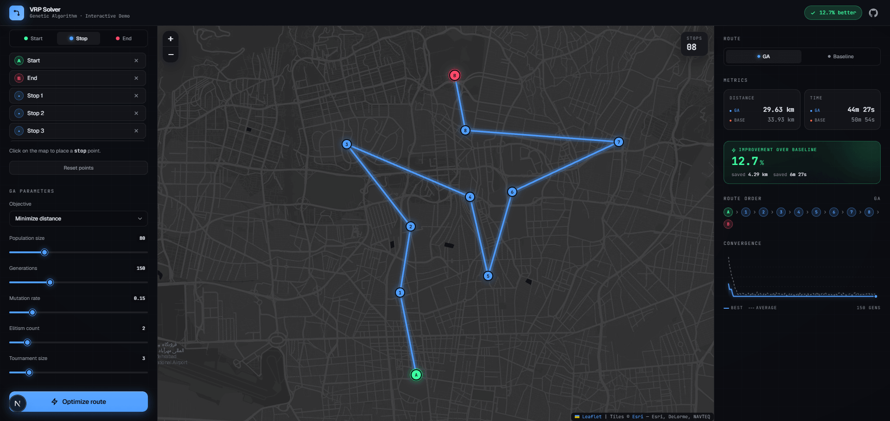

# VRP Genetic Algorithm Demo

A browser-based Vehicle Routing Problem solver. Place points on a map, tune a genetic algorithm (GA) while it runs, and compare the route it finds with a nearest-neighbor baseline.

I wrote this GA in Python for my B.Sc. thesis in Geomatics Engineering (GIS). This repo ports it to TypeScript and puts a map UI on top, so you can try the algorithm without reading the code. The same algorithm is also published on PyPI as [`vrp-solver`](https://pypi.org/project/vrp-solver/).

[](https://github.com/alan-shabrandi/vrp-demo/actions/workflows/ci.yml)
[](https://github.com/alan-shabrandi/vrp-demo/actions/workflows/python-solver.yml)
[](https://pypi.org/project/vrp-solver/)
[](./LICENSE)

**[Live demo](https://vrp-demo-phi.vercel.app)**



## What it does

- Place a start (A), an end (B) and up to 25 stops on a dark map.
- Change the GA parameters: population size, generations, mutation rate, elitism, tournament size and objective.
- See the best visit order the GA finds, next to a nearest-neighbor route, with the improvement in percent.
- Switch between the two routes on the map and in the results panel.
- Watch the best and average fitness per generation in a small convergence chart.
- Load one of three preset scenarios, or press <kbd>Ctrl</kbd>/<kbd>⌘</kbd> + <kbd>Enter</kbd> to run.

## Getting started

```bash
npm install
npm run dev
```

Open <http://localhost:3000>. The page starts with a start and an end point and no route. Load a preset or click the map to add stops, then select **Optimize route**.

| Command | What it does |
| --- | --- |
| `npm run dev` | Development server |
| `npm run build` / `npm start` | Production build and server |
| `npm test` | Run the Vitest suite once |
| `npm run ci` | Typecheck, lint, format check, tests and build, in the order CI runs them |

No environment variables are needed. The app deploys to Vercel as is.

## How the algorithm works

The problem is an open VRP with a fixed start and end: one vehicle, one trip, every stop visited once.

- **Chromosome:** a permutation of the stop IDs. Start and end are added around it when a route is evaluated.
- **Selection:** k-way tournament.
- **Crossover:** order crossover (OX), so children are always valid permutations.
- **Mutation:** swap two stops, applied to each offspring with the configured probability.
- **Elitism:** the best N individuals are copied unchanged into the next generation, so the best fitness never gets worse.
- **Fitness:** total haversine distance, or total travel time at a constant 40 km/h.

Because the speed is constant, the time objective ranks routes exactly like the distance objective. It changes the numbers shown, not the route found.

The baseline is nearest-neighbor: from the current point, always go to the closest unvisited stop. I haven't compared the GA against 2-opt or OR-Tools, so the improvement figure only tells you how much the GA beats a greedy route.

### Limits

- Travel time is a straight-line estimate at constant speed, not a road-network ETA.
- One vehicle only.
- At most 25 points. The solver runs inside a single API route and blocks the Node event loop while it works.

## Python package

The same algorithm is available as a standalone package with a CLI:

```bash
pip install vrp-solver
vrp-solver problem.json
```

The input is the same JSON as the HTTP API below. See [`packages/vrp-solver/README.md`](./packages/vrp-solver/README.md) for the Python API.

The two implementations share no code. What connects them is `packages/vrp-solver/tests/test_cross_validation.py`, which runs both with the same seed and compares routes, fitness values and histories. If you change the algorithm in one language, update the golden values and run both test suites. The history of the project (thesis, web demo, package) is in [`docs/PROVENANCE.md`](./docs/PROVENANCE.md).

## API

`POST /api/optimize`

```json
{
  "points": [
    { "id": "start", "lat": 35.6892, "lng": 51.389, "role": "start" },
    { "id": "s1", "lat": 35.7005, "lng": 51.4013, "role": "stop" },
    { "id": "end", "lat": 35.7795, "lng": 51.4033, "role": "end" }
  ],
  "config": {
    "objective": "distance",
    "populationSize": 80,
    "generations": 150,
    "mutationRate": 0.15,
    "elitismCount": 2,
    "tournamentSize": 3,
    "randomSeed": 42
  }
}
```

The response contains the GA solution (`sequence`, `totalDistance`, `totalTime`, `fitness`, `history`, `generationsRun`), the nearest-neighbor solution in the same shape without `history`, and `improvementPercent`.

`improvementPercent` is a fraction between 0 and 1, not a percentage: `0.0856` means 8.56% shorter than the baseline.

Invalid input returns `400` with `{ "error": "..." }`. The limits are defined in `src/lib/constants.ts`. `randomSeed` is optional; leave it out for a different result on every run, set it for a reproducible one.

## Testing

```bash
npm test                                   # web app (Vitest)
cd packages/vrp-solver && uv run pytest -v # Python package
```

The web tests cover the algorithm and the pure helpers in `src/lib/`: haversine distance, the GA operators, request validation, formatting, and a check that the GA is deterministic for a fixed seed and never worse than the baseline. React components and hooks are tested by hand, not automatically.

## Project structure

```text
src/
  app/            Next.js app, the /api/optimize route and the CSS files
  components/     UI: control panel, map, results, shared elements
  hooks/          useOptimize, useKeyboardShortcut, useDynamicTitle
  lib/            Algorithm, validation and helpers (no React)
tests/            Vitest tests for lib/
packages/
  vrp-solver/     Python package published on PyPI
docs/             Screenshot and project notes
```

## More documentation

- [`ARCHITECTURE.md`](./ARCHITECTURE.md): layers, data flow and design trade-offs
- [`docs/DESIGN.md`](./docs/DESIGN.md): visual design, map styling and accessibility
- [`docs/PROVENANCE.md`](./docs/PROVENANCE.md): how the project went from thesis to web demo to package

## License

MIT. See [`LICENSE`](./LICENSE).